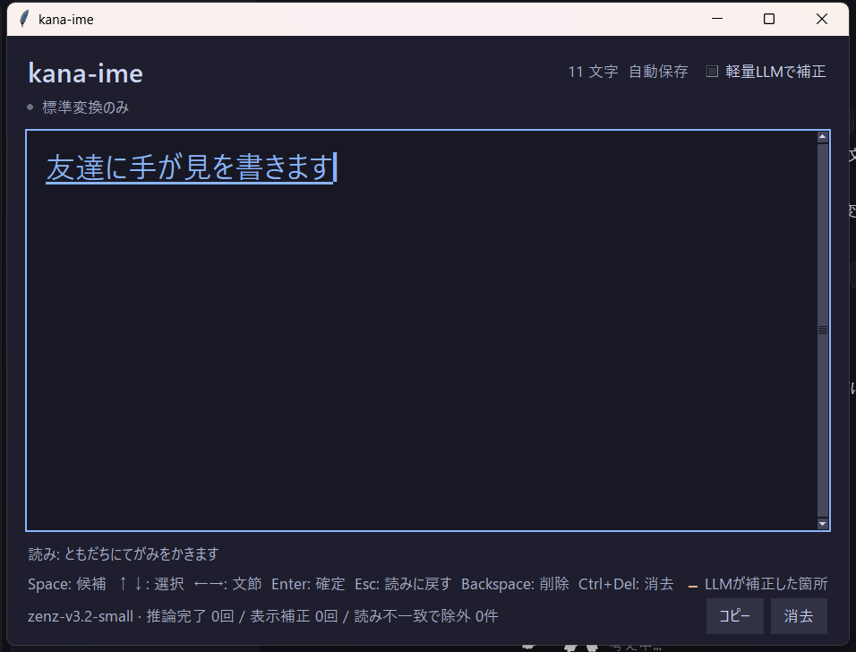
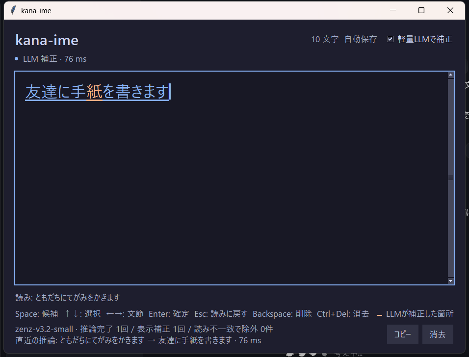
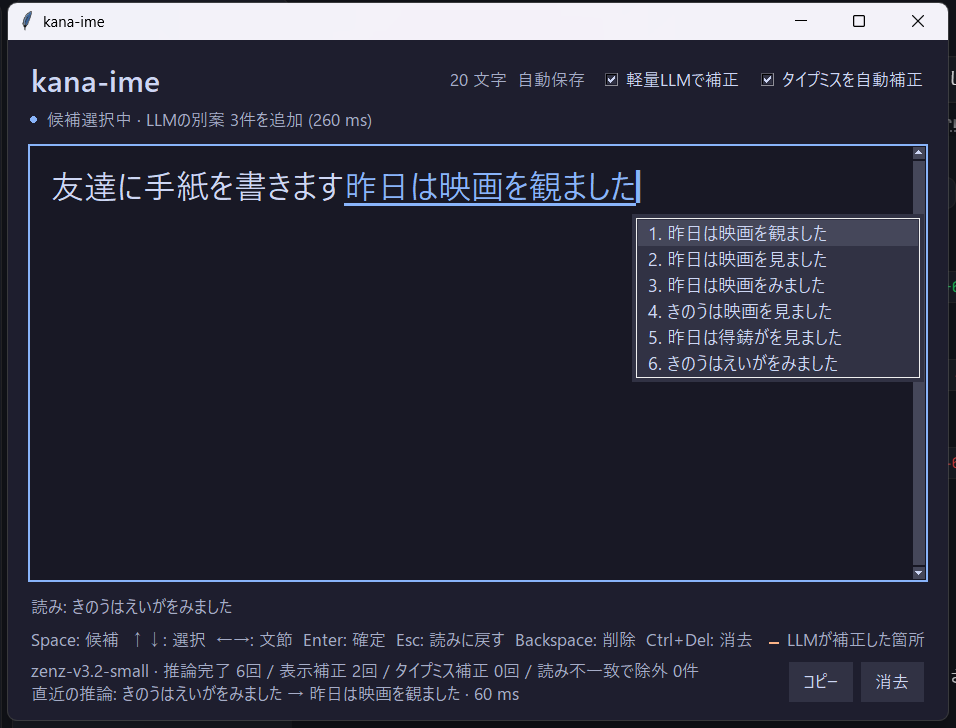
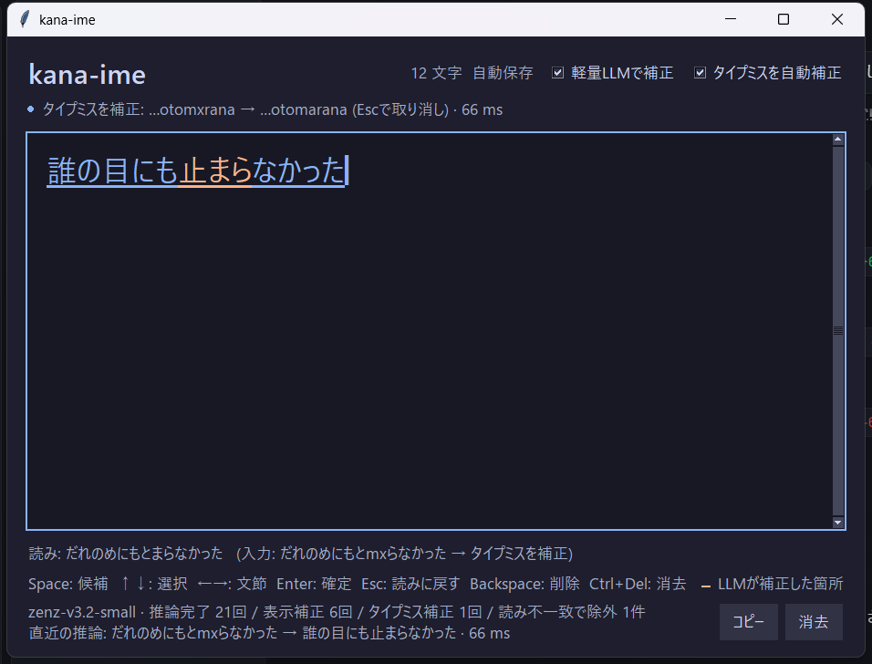

# kana-ime — 日本語変換プレイグラウンド (Windows版)

macOS向けの Hitsuji-IME Playground と同じコンセプトを、Windows + Python で再実装した変換プレイグラウンドです。

1. 標準変換(辞書 + 動的計画法)を **即時** に表示する
2. ローカルの LLM `zenz-v3.2-small` が **少し遅れて** 未確定文を補正する(LLMが直した箇所はオレンジ)

入力した文章は外部へ送信しません(推論はすべてこのPC上)。GPU不要です。

## セットアップ

`setup.bat` をダブルクリックすると、下の手順をまとめて行います (初回のみ。10分ほどかかります)。
手で行う場合:

```bash
pip install -r requirements.txt
python build_dict.py        # 変換辞書 reading_dict.pkl を生成 (初回のみ)
python build_verbs.py       # 動詞・形容詞の活用形 verb_dict.pkl を生成 (初回のみ)
python download_model.py    # zenzモデル(約74MB)を取得してSHA-256を検証 (初回のみ)
python main.py              # 起動
```

セットアップ後は、フォルダ内の `kana-ime.bat` をダブルクリックしても起動できます。

`models/zenz-compat.gguf` は初回起動時に自動生成されます(下の「モデルについて」参照)。
LLMが使えない場合(モデル未取得など)は標準変換だけで動きます。

## ファイル構成

```
kana-ime/
├── main.py            起動エントリ (画面・キー入力・LLM結果の反映)
├── engine.py          変換エンジン (ローマ字→かな→漢字、状態管理)
├── llm.py             zenzによる遅延補正 (別スレッドの推論ワーカー)
├── reading_check.py   LLM出力と入力の読みの整合チェック
├── build_dict.py      読み→漢字の逆引き辞書を生成
├── build_verbs.py     動詞・形容詞の活用形辞書を生成
├── download_model.py  zenzモデルの取得と検証
├── patch_model.py     標準llama.cpp向けの互換モデルを作る
├── requirements.txt
├── models/            zenzモデル (git管理外にすること)
└── dev/               テスト (test_engine / test_llm / test_app) と調査用スクリプト
```

## キー操作

| キー | 動作 |
|---|---|
| ローマ字 | 入力 (例: `kyouhagakkou`)。`を` は `wo` |
| Space | 文節候補の選択を開始 / 次の候補 |
| Shift+Space / ↑ | 前の候補 |
| ↓ | 次の候補 |
| ← / → | 文節を移動 |
| Enter | 全文確定 (未入力なら改行) |
| Esc | 標準変換に戻す (LLM補正も解除) |
| Backspace | 末尾削除 |
| Ctrl+Delete | 全消去 |
| 候補をクリック / ダブルクリック | その候補を選ぶ / その候補で確定 |

Windows の日本語入力 (Microsoft IME など) は **オフ (半角英数)** にして使ってください。

## ローマ字変換 (roman.py)

一般的なIMEと同じ規則の自前の変換です (以前使っていた jaconv の問題を避けるため)。

- 打ちかけの子音は英字のまま表示する (`tomodach` → ともだch)。jaconv は「ともだっっ」に化けていた
- `konnichiha` → こんにちは、`minna` → みんな (jaconv は こんいちは / みんあ)。ん+母音は `n'` (`kin'en` → きんえん)
- どの綴りにもならない文字 (タイプミス) は英字のまま残す。確定時、末尾の `n` は ん になる

## タイプミスの自動補正 (typo.py)

「タイプミスを自動補正」がオンのとき、変換を出したあと手が止まっている間にタイプミスを探して直します。
直したときは、上の欄に どこを直したか (例: `…otomxrana → …otomarana`) が出ます。**Esc で取り消せます**
(取り消した入力は、その文を打ち終わるまで二度と直しません)。候補にもミスのままの変換が残ります。

仕組み:

1. LLM(zenz) に読みを通し、かな1文字ずつの「ありえなさ」(対数確率) を測る。英字のまま残った文字も怪しい箇所にする
2. 怪しい箇所のまわりだけ、ローマ字を1文字直した候補を作る (隣のキー・打ち忘れ・余分・2文字の入れ替え)
3. 変わった最初の文字の確率で24件に絞り、変わった部分とその後ろ4文字だけをLLMで採点し直す
4. 元の読みより十分に自然 (基準 6.0) なら置き換える。読みが短いほど有利になる偏りは、かな1文字あたり 2.5 の加点で打ち消す

評価 (Anthy corpus.1 から各200件、`python dev/eval_typo.py 200`):

| 指標 | 結果 |
|---|---|
| 1文字のミスを元に戻せた | 102 / 200 (51%) |
| 別の読みに変えてしまった | 2 / 200 |
| 正しく打った文を直してしまった | 0 / 200 |
| 打っている途中の文を直してしまった | 0 / 200 |
| かかる時間 | 中央値 0.39秒 / 90% 1.1秒 (変換を出したあと、裏で) |

ミスの種類別では、2文字の入れ替え (37/48) と隣のキー (31/57) に強く、打ち忘れ (13/55) は苦手です。
打ち忘れは、1文字抜けても別の正しいかなになることが多く、それが本当にミスかを見分けにくいためです。
基準値は「正しい文を勝手に直さない」ことを最優先に決めました (誤補正を0件に保てる範囲で、直せる数が最大の組)。

「軽量LLMで補正」のチェックで補正のオン/オフを切り替えます。

## LLM補正の挙動

macOS版と同じ方針です。

- 推論は別スレッドで常に1件ずつ。実行中の入力は最新の1件にまとめる
- 結果には入力の世代IDを付け、古い結果は本文に反映しない (診断表示にだけ記録)
- 候補選択中は補正を一時停止。Spaceで選択に入ると、補正結果が第一候補になる
- 補正済みの読みに触れない追加入力では、補正済みの部分を保持する
- 長い読みは句読点・100文字で分割し、前の変換結果を次の文脈に使う。文脈は現在の文の左側40文字だけ (前の文は渡さない。下の評価を参照)
- 同じ(文脈, 読み)の結果は128件までキャッシュ
- 補正結果は標準変換との差分だけオレンジで表示する

実測では1回あたり約50〜100ms (CPU)。ただし「必ず良くなる」保証や校正機能ではありません。

## 変換精度

標準変換は辞書ベースです。

- 助詞・助動詞・複合語: `engine.py` 内の文法辞書 (手書き)
- 名詞など: pykakasi の辞書を逆引き (約16.8万エントリ)
- 動詞・形容詞の活用: `build_verbs.py` が MeCab(ipadic) で活用型を判定して自動生成 (約3.6万の読み)
  - 例: 学ぶ → 学ばない / 学びます / 学んで / 学んだ / 学べば / 学ぼう / 学んでいます
  - 五段・一段・イ形容詞に対応。サ変 (勉強する) は名詞 + する の組み合わせで扱う

**既知の限界**: 標準変換は辞書にない語に弱く (朝ご飯・手紙・映画・走る など)、ここは LLM 補正が埋めます。
LLMを切ると、こうした語は誤変換になります。

## モデルについて

`zenz-v3.2-small` (Miwa-Keita, Apache-2.0) の Q5_K_M を使います。

macOS版は azooKey 同梱の llama.cpp を使いますが、そこだけが知っている前処理名
`gpt2-small-japanese-char` を、標準の llama.cpp (llama-cpp-python) は読み込めません。
そのため `patch_model.py` が `tokenizer.ggml.pre` を `default` に置き換えた複製
`models/zenz-compat.gguf` を作ります (元のファイルは変更しません)。
トークナイザは文字単位のBPEなので影響は小さいはずですが、全入力での同等性は検証していません
(`dev/test_llm.py` の8文と実験した数文では、期待どおりの変換が出ています)。

プロンプトは `\uEE02{左文脈}\uEE00{読み(カタカナ)}\uEE01` の順で、出力が変換結果です。

## テスト

```bash
python dev/test_engine.py   # 標準変換 (辞書のみ)
python dev/test_roman.py    # ローマ字変換 (コーパス1,676文の往復を含む)
python dev/test_reading_check.py  # 整合チェック (数字の値・助数詞・打ちかけを含む 92件)
python dev/eval_typo.py 200 # タイプミス補正の評価 (約20分)
python dev/test_llm.py      # zenz補正 (ヘッドレス。幻覚の差し替え・別案も検証)
python dev/test_app.py      # 画面を含む結合テスト (キー入力→補正→候補→別案→確定→幻覚の除外)
python dev/eval_reading_check.py all   # 整合チェックの評価 (初回はコーパスを取得)
python dev/eval_prefixes.py 150        # 打ちかけの位置での整合チェックの評価
python dev/eval_alternatives.py all    # 別案の評価 (約5分)
python dev/screenshots.py              # 実際のウィンドウを開いて撮影 (dev/data/screens/)
python dev/eval_context.py             # 前の文を文脈に渡す効果の評価
```

## macOS版との違い

| 項目 | macOS版 (Hitsuji-IME) | kana-ime |
|---|---|---|
| 言語 / UI | Swift / SwiftUI + AppKit | Python / tkinter |
| 標準変換 | AzooKeyKanaKanjiConverter | 文法辞書 + pykakasi逆引き + 活用形生成 + DP |
| LLM | zenz + Zenzai (変換器と連携した制約付き探索) | zenz の貪欲生成 (llama-cpp-python, CPU) |
| 対応OS | macOS 14+ Apple Silicon | Windows 10/11 |

macOS版のZenzaiは、LLMの出力を変換器の候補と突き合わせながら探索します。
kana-ime はそこまでは行わず、LLMの出力を生成したあとで **読みの整合チェック** (下記) にかけます。

## 読みの整合チェック (reading_check.py)

LLMが読みと無関係な文字を出しても画面に出さないための安全弁です。
出力が入力の読みを「ちょうど説明できる」かを調べ、説明できないチャンクは標準変換の結果に差し替えます。
差し替えが起きると、画面の診断欄に件数が出ます。

出力の各位置で、次のどれかで入力の読みを消費できるかを探索します。

- MeCab(ipadic) の形態素の読み
- 辞書にある熟語の読み (一人=ひとり、三日=みっか。MeCabが細かく切る語を拾う)
- 漢字1文字ずつの読み、かな・記号はそのまま
- 数字は **値の読み** と一致するか (2週間=にしゅうかん。3週間なら不一致)。助数詞つきの特別な読みも扱う
  (二人=ふたり、三日=みっか、四月=しがつ、七時=しちじ、二十歳=はたち、六本=ろっぽん、十分=じゅっぷん)。
  小数・先頭が0の桁数字・巨大な数だけは、数詞の読みの並びなら通す
- 英字はカタカナ語の表記 (LINE=らいん)。文字数が近いかなの並びなら通す
- 長音「ー」は直前の母音として比べる (こおひい = こーひー)

**見分けられないもの**: 同音異字 (橋/箸)。読みが同じなので、チェックでは判断できません。
LLMの文脈と別案 (下記) で扱います。英字はつづりの正しさも見ていません (LINE と LIME の区別はできない)。
また「出力が読みを説明できない」だけを見ているので、入力にない句読点・記号 (末尾の「?」、「()」) も除外されます。

### 評価 (Anthy corpus.1 / 1,676文 / `python dev/eval_reading_check.py all`)

| 指標 | 結果 |
|---|---|
| 正解の文を通す | 1,673 / 1,676 (99.8%) |
| かな1文字を壊した文を拒否 | 1,642 / 1,642 (100%) |
| 別の文の結果を拒否 | 1,675 / 1,676 (99.9%) |
| LLM出力の完全一致 (チェックなし) | 72.1% |
| LLM出力の完全一致 (チェックあり) | 72.1% |
| チェックで除外した出力 | 3 / 1,676 (0.2%) |

- **完成した文では、LLMが読みと無関係な文字を出した例は見つかりませんでした。**
  除外した3件は、入力にない記号 (「()」「?」) が2件、辞書に読みのない語 (煮干し) が1件です。
- **ところが、入力の途中 (打ちかけ) では幻覚が実際に出ます。** 実際の入力は1文字ごとに
  「そこまでの読み」がLLMに渡るので、こちらが本番です (下の「打ちかけでの評価」)。
- 最初の版では、数字・英字・熟語で正解を誤って除外し、完全一致が72.1%から71.2%に下がりました。
  上の版は、その誤拒否を直したあとの結果です。
- 標準変換のみの完全一致は4.2%です。差し替え先の標準変換は文全体では弱いので、
  差し替えが起きた箇所は誤変換になりやすいです。
- 「通ったが不正解」が27.7%あります (同音異字や表記ゆれ)。これはチェックの守備範囲外です。
- 数字の値のルールは、コーパスに数字がほとんど出てこないため、主に単体テスト
  (`dev/test_reading_check.py` の数字の例) で確かめています。コーパスでは正解の受理率・完全一致とも変わりません。
- 評価データ (`dev/data/`) はgit管理に含めないでください。

### 打ちかけでの評価 (`python dev/eval_prefixes.py 150`)

Anthyの先頭150文を、1文字ずつ打つ途中の全ての位置 (2,459通り) でLLMに通しました。

| 指標 | 最初の版 | 現在 |
|---|---|---|
| 除外された出力 | 60 / 2,459 (2.44%) | 18 / 2,459 (0.73%) |
| うち完成した文 | 0 / 150 | 0 / 150 |

除外された18件は、ほぼ全部が本物の幻覚です:
繰り返し (「あめ」→「アメアメアメ」、「あんぜんほしょ」→「安全保障保障保障…」、「いっぱん」→「一般一般一般…」)、
絵文字・記号 (「安全⭐」「仕事時間😑」「明日〇」「アニメ見て(笑)」)、入力より長い出力 (「いれ」→「入れてくれるといい」)。

最初の版が落としていた正しい出力は、次の2つで通すようにしました。

- **語幹の読み**: 辞書の「降る=ふる」から「降=ふ」を作り、送り仮名の前で切れた形 (「雨が降」「出会」「読」) を認める
- **最後の語の途中**: 最後のチャンクだけ、読みが語の途中まででもよい (「きにゅ」→「記入」、「いっ」→「一」)。
  完成した読みや、句読点で終わるチャンクには使わない。繰り返し・記号・絵文字は、この緩和でも通らない

## LLMの別案 (候補に追加)

Spaceで全文の候補が開いたとき、LLMの別案を後から候補に足します。
候補の並びは `[LLMの補正結果, 別案1, 別案2, 別案3, 標準変換, 読み]` です。
生成は候補を開いたあとに非同期で行い、届くまで候補の操作はそのまま続けられます。

作り方: LLMの最短の出力で、確率差が小さい位置だけを別のトークンに替えて、続きを作り直します。
全体の確率で並べ、読みの整合チェックを通らない案は捨てます。

評価 (Anthy corpus.1 / 1,676文 / `python dev/eval_alternatives.py all`):

| 指標 | 結果 |
|---|---|
| LLMの最短の出力が不正解の文 | 469 / 1,676 |
| 別案の上位1件に正解が入る | 259 / 469 (55.2%) |
| 別案の上位3件に正解が入る | 355 / 469 (75.7%) |
| 別案の上位5件に正解が入る | 367 / 469 (78.3%) |
| 完全一致 (最短のみ → 上位3件の別案まで見る) | 72.0% → 93.2% |
| 別案の生成時間 | 平均 約0.6秒/文 (非同期) |

注意:
- 93.2%は「正解が選べる位置に出ている」割合で、最初から出る変換が良くなるわけではありません。
- 不正解の中には表記ゆれ (行く/いく、良い/よい、3年/三年) が多く含まれます。コーパスの表記と同じでないだけで、
  読んで正しい文も「不正解」に数えています。別案はその表記違いを選べる形にもなります。
- 別案は **全文の候補** のときだけ出ます。LLMの補正が標準変換と同じ文では、従来どおり文節ごとの候補になり、
  別案は出ません (文節の候補に同音異字が並んでいるため、橋/箸のような選び直しはそこでできます)。
- 「は紙を使う」のように、読みには合うが意味のない案が混ざることがあります。

## 画面 (`python dev/screenshots.py` で撮影)

標準変換だけ (LLM補正の前) → LLMが補正 (書き換えた箇所がオレンジ) → 候補とLLMの別案。









## 前の文を文脈に渡すか (評価して見送り)

LLMに渡す左文脈は、現在の文の左側だけ (最大40文字) です。前の文は渡しません。
前の文を渡すと手がかりになる一方、前の話題に引きずられるためです。手作りの小規模評価で確かめました
(`python dev/eval_context.py`。手がかりになる前文あり14件、誤解を招く前文あり8件):

| 文脈の渡し方 | 手がかりあり | 誤解を招く前文あり |
|---|---|---|
| なし / 現在の文の左側だけ | 12 / 14 | 6 / 8 |
| 前の文を含む直前40文字 | 13 / 14 | 4 / 8 |
| 前の文を含む直前80文字 | 13 / 14 | 4 / 8 |

前の文を渡すと「財布の硬貨 → 効果がある」が「硬貨がある」になるなど、**悪化する例の方が多く**、差し引きでマイナスでした。
件数が少ないので目安であって統計的な結論ではありません。ただし、macOS版が前文を切り捨てている判断とも一致します。

## 今後

1. 標準変換の辞書拡充 (Mozc OSS辞書など)。差し替え先と、LLMを切ったときの精度が上がります
2. 確定済み文章の任意位置編集、ユーザー辞書
3. Windows の入力ソース (TSF) 化
